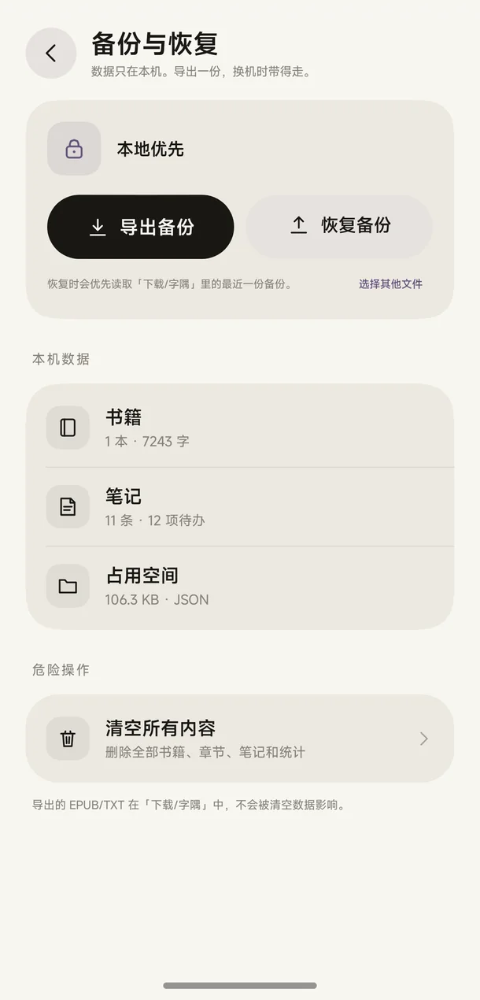
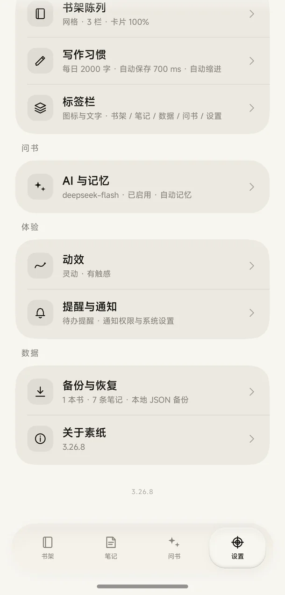

<h1 align="center">素纸</h1>

<p align="center">一个安静的手机写作应用。<br>
没有账号，没有云同步，写完就存在这台手机里。</p>

<p align="center">
  
  
  
</p>
<p align="center">
  
  
  
</p>

---

## 能写什么

**书和章节**
书架上一本书一张封面，点开就是正文。每章单独保存，写完一章开下一章，目录里随时跳。

**排版**
字号、行距、页边距、稿纸线、字体都能调，调完立刻看到。三套底色、八个点缀色，还能自己拉色相；深浅色跟着手机走。

**笔记**
写到一半想到的事，记成笔记挂到某一章上。待办可以带时间提醒。

## 写不动的时候

**问书**
AI 读过你写的这本书。可以问「第三章张满的动机够不够」，它会引原文回答，也能自己翻全书找线索。
开了「深度思考」会先把问题拆开、逐条核对原文再答。

**校核**
选中一段，查错别字、标点、病句。建议一条条列出来，采纳就原地换掉，不采纳就跳过。

**修饰**
选中一段，让它把「他很生气」写成他做了什么。

## 写完以后

**导出** EPUB 和 TXT，拿去投稿或者自己排版。
**备份** 导出一个 JSON 文件，换手机导回去接着写。

## 下载

[Releases](https://github.com/3Cne/ziyu/releases) 里下最新的 `ziyu-*.apk`，手机上点开装（要允许「安装未知来源应用」）。

- Android 8.0 以上
- 覆盖安装不会丢数据（签名没变过）

> 这个 App 以前叫「字隅」。名字改了，包名和存储目录没改，所以旧数据、旧备份都还在。

## 数据在哪

不联网也能写完一整本。数据就是手机里的一个 JSON 文件，导出的备份你能自己打开看。

只有在「设置 → AI 与记忆」里填了自己的 API Key，它才会联网，而且只连你填的那个地址。Key 存在系统加密存储里，不进备份。

## 从源码构建

需要 JDK 17 和 Android SDK。

```bash
git clone https://github.com/3Cne/ziyu.git
cd ziyu
./gradlew :app:assembleRelease
```

发布版要在根目录放 `keystore.properties`（已在 `.gitignore` 里）：

```properties
storeFile=your.keystore
storePassword=...
keyAlias=...
keyPassword=...
```

APK 在 `app/build/outputs/apk/release/`。
