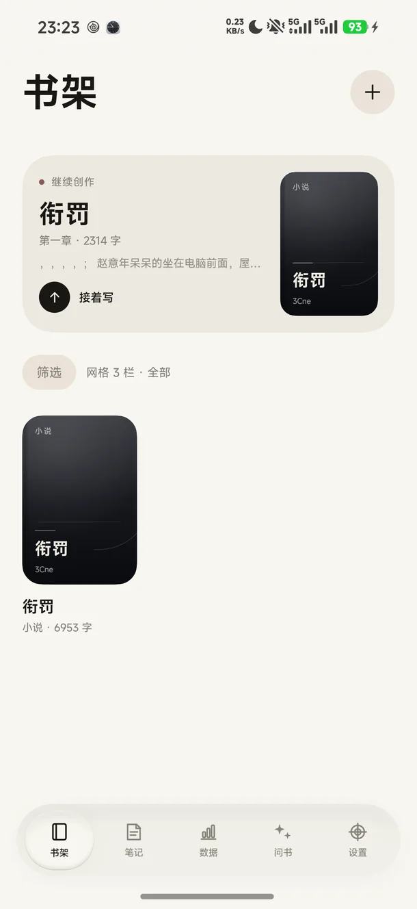
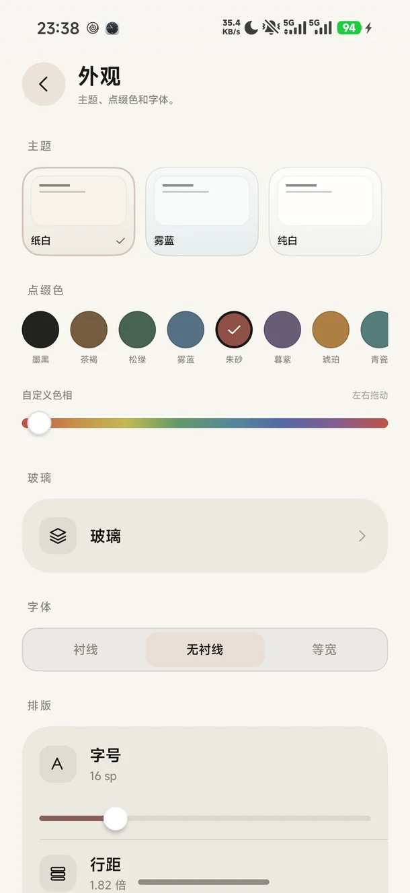

<h1 align="center">素纸</h1>

<p align="center">手机上写小说、写长文用的 App。</p>

<p align="center">
  
  
  
</p>
<p align="center">
  
  
  
</p>

---

书架上一本书一张封面，点开就写。一章一份，写完这章再开下一章。

排版都能调：字号、行距、页边距、稿纸线、字体。底色有三种，点缀色八个，也能自己拉色相。深色浅色跟着手机走，不用单独切。

写到一半想到什么，记成笔记挂到这一章上，待办能带时间提醒。

## AI

问书读的是你正在写的这本，不是通用问答。

问「第三章张满为什么知道赵念有嫌疑」，它翻原文回答。开「深度思考」会先把问题拆开，逐条核对再说。

选中一段另有两件事：校核挑错别字、标点、病句；修饰把「他很生气」写成他做了什么。

这些要自己在设置里填 Key，不填也能用，只是没有 AI。

## 导出

EPUB 和 TXT，存到 `下载/字隅`。备份是 JSON，换手机导回去接着写。

## 装

[Releases](https://github.com/3Cne/ziyu/releases) 里下 APK，Android 8.0 以上点开装。

以前叫字隅，现在叫素纸。包名没换，旧数据、旧备份都还在。

## 自己编译

JDK 17、Android SDK 37，根目录：

```bash
./gradlew :app:assembleRelease
```

签名参数从 `keystore.properties` 读（已 gitignore）。
