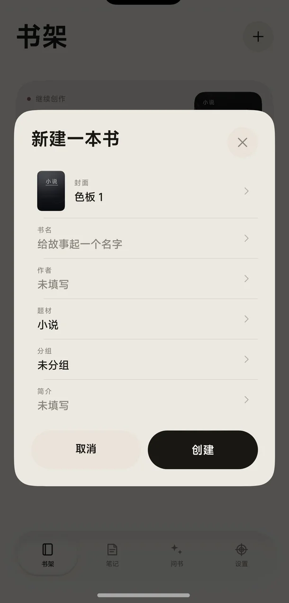
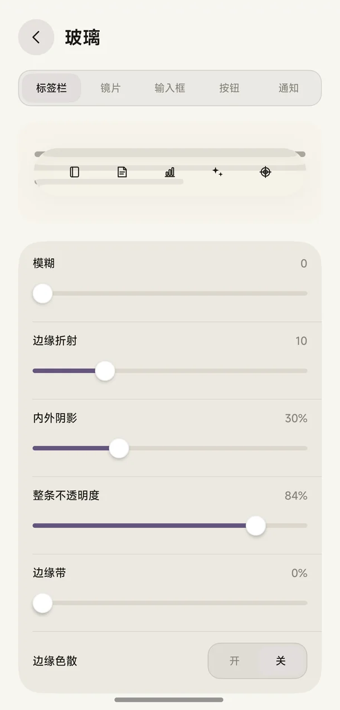

<h1 align="center">字隅</h1>

<p align="center">一个安静的移动写作空间。<br>
书、章节、笔记、待办、问书 —— 全部留在这台手机里。</p>

<p align="center">
  
  
  
</p>
<p align="center">
  
  
  
</p>

---

## 它是什么

字隅是一个 Android 写作 App，为「一个人安安静静写长篇」这件事做的。

没有账号，没有云同步，没有订阅。打开就能写，写完就在这台手机上。
书架上放书，书里分章，每一章单独保存；写到一半想到的事，可以随手记成笔记，挂到某一章上。

技术上是一个纯 Jetpack Compose 应用，包名 `com.moyu.writer`，最低支持 Android 8.0（API 26）。

## 特色

**像纸一样直接**
点进正文就能打字，稿纸横线跟着排版走。字号、行距、字色、页边距都能调；撤销重做、缩进、引号、分节、排版工具在底部一条能力栏里，收起时缩成一颗球，不挡字。

**液态玻璃材质**
标签栏、选中的镜片、输入框、按钮、对话框都是玻璃：模糊、边缘折射、色散、边缘带、内外阴影，每一项都能在「设置 → 外观 → 玻璃」里单独拖，旁边有实时预览。

**「水滴滑动」动效**
镜片移动时会被速度拉长，到站时轻轻挤一下。全 App 的按钮按下都有一点点形变，笔记和校核面板是从右边「抽」出来的。动画跑在 120Hz 上，弹簧参数统一调过。

**问书**
第 5 个标签页。AI 读的是你正在写的这本书：可以点名引用某一章或某条笔记来提问，回答会带上原文依据。开了「深度思考」会先拆问题再逐条核对原文。回答下面有一行「用了 N 个工具」，展开能看到它每一步做了什么 —— 搜全书、读章节、建笔记、设提醒、读附件都在里面，删除类操作要你二次确认。

**正文校核**
选中一段，让它挑毛病：本地规则先过一遍（重复用词、标点、长句、专名一致性），需要的话再交给 AI。建议一条条列在右侧浮窗里，采纳或忽略，采纳后正文原地替换、视图不跳。

**数据在你自己手里**
没有服务器。数据就是 `filesDir` 里的一个 JSON，导出备份得到一个文件，换机时导回去就能继续写。也能导出 EPUB 和 TXT 拿去投稿或排版。

**主题**
三套底色（纸白 / 雾蓝 / 纯白）× 八个点缀色（墨黑、茶褐、松绿、雾蓝、朱砂、暮紫、琥珀、青瓷），还能自定义色相；深色模式是另一套配色，不是简单反色。

## 下载

到 [Releases](https://github.com/3Cne/ziyu/releases) 下载最新的 `ziyu-*.apk`，手机上点开安装即可（需要允许「安装未知来源应用」）。

- 最低 Android 8.0（API 26）
- 包名 `com.moyu.writer`，签名保持不变，覆盖安装不会丢数据

## 构建

需要 JDK 17 与 Android SDK（`compileSdk 37`）。

```bash
git clone https://github.com/3Cne/ziyu.git
cd ziyu
./gradlew :app:assembleRelease
```

产物在 `app/build/outputs/apk/release/`。

发布构建要在仓库根目录放一个 `keystore.properties`：

```properties
storeFile=your.keystore
storePassword=...
keyAlias=...
keyPassword=...
```

`keystore.properties`、`*.keystore`、`local.properties` 都在 `.gitignore` 里，不会进仓库。

推一个 `v*` 标签，`.github/workflows/release.yml` 会用仓库 Secrets 里的签名信息构建并发布到 Releases。

## 隐私

- 不收集任何数据，没有分析 SDK，没有崩溃上报。
- 只有你在「设置 → 问书 → AI 与记忆」里填了 API Key，App 才会联网，且只连你填的那个服务地址。
- API Key 存在 AndroidKeyStore 加密文件里，不写进 `moyu.json`，备份里也不含 Key。

## 关于这个仓库

从 3.9.37 到 3.14.2 的迭代一直在本地进行，2026-11 才整理入库；更早的历史在 `master` 分支上（3.7.110 基线）。`main` 分支只放源码、截图和这份说明。
