<h1 align="center">素纸</h1>

<p align="center">手机上写小说、写长文用的 App。</p>

<p align="center">
  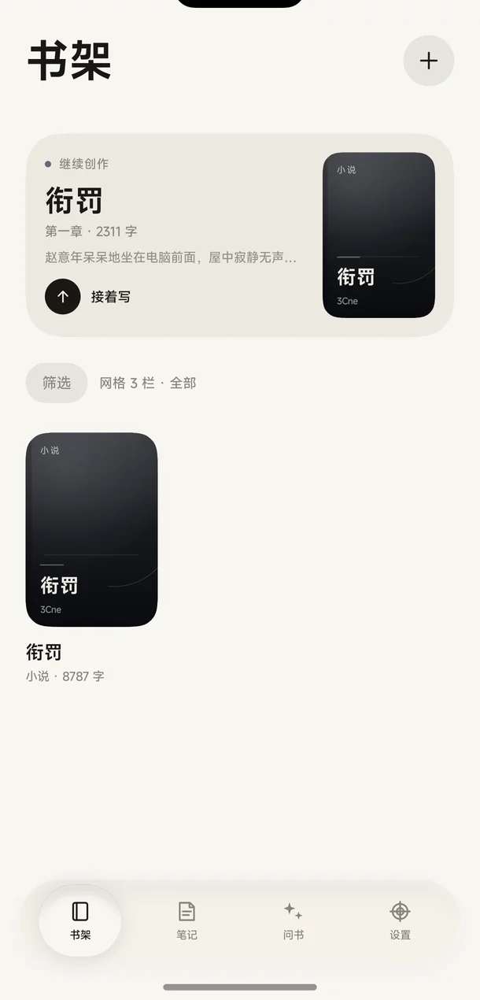
  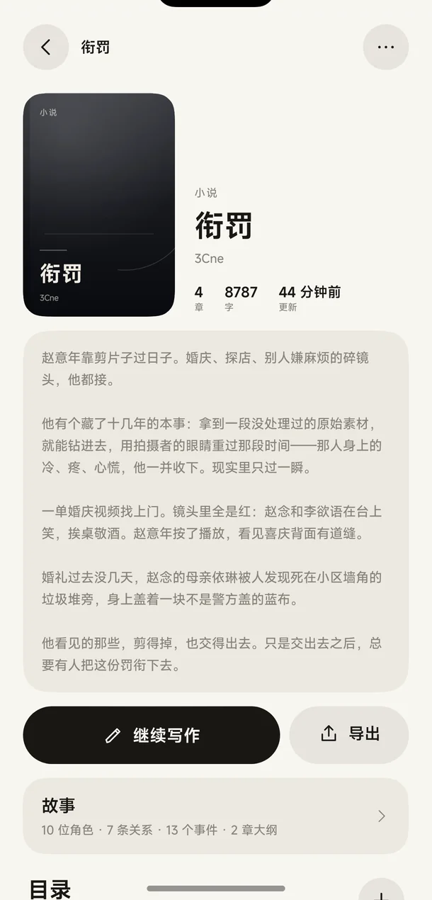
  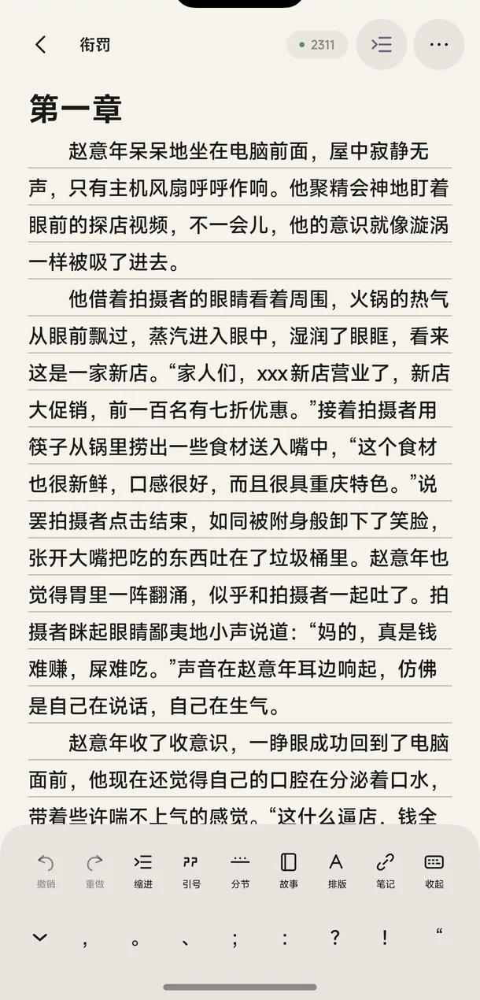
</p>
<p align="center">
  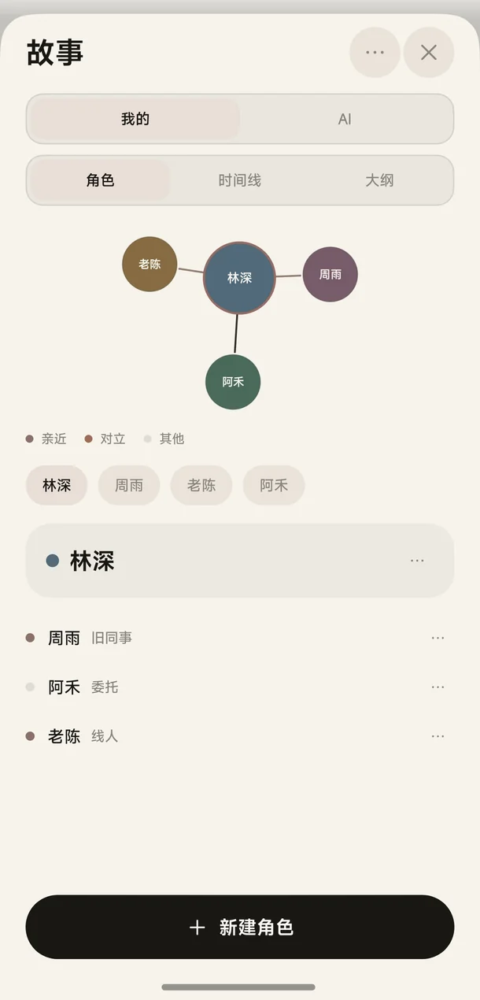
  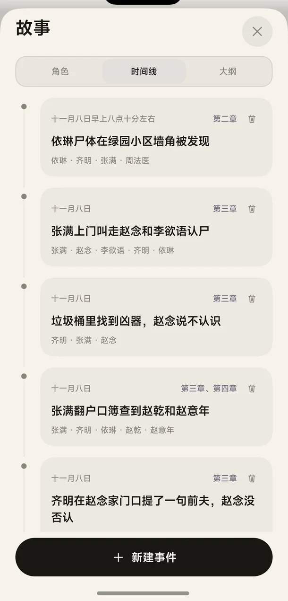
  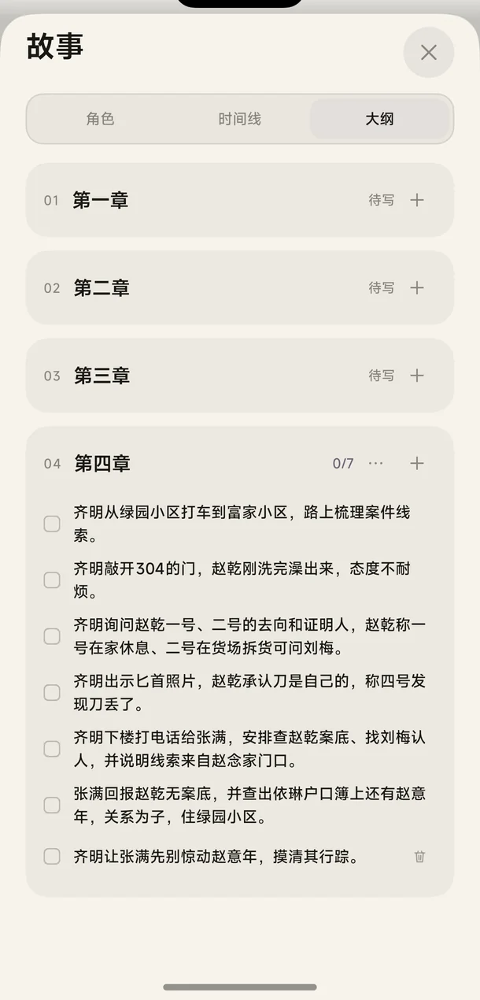
</p>
<p align="center">
  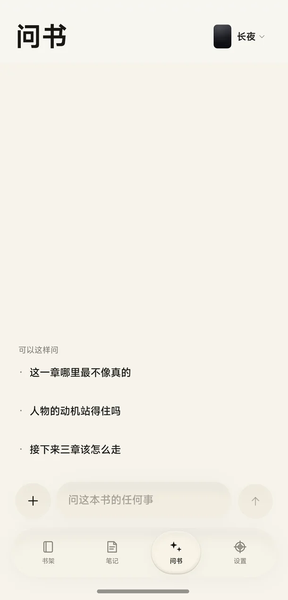
  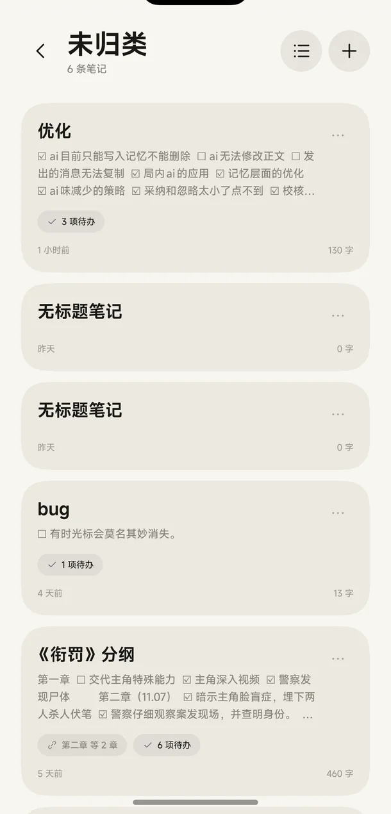
  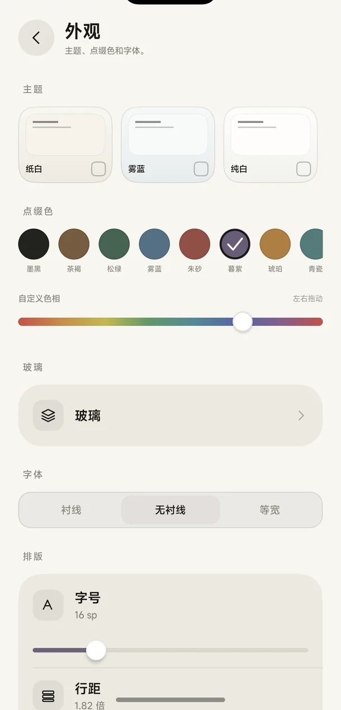
</p>
<p align="center">
  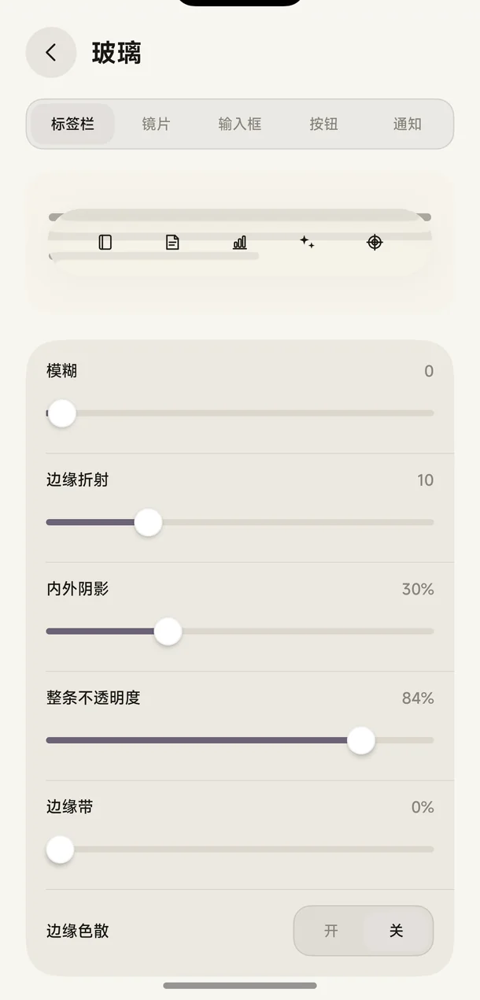
  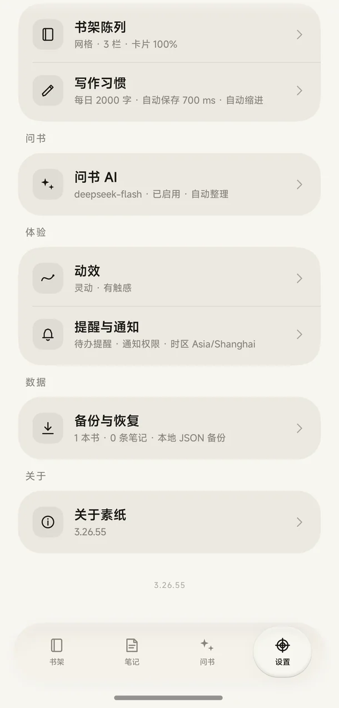
  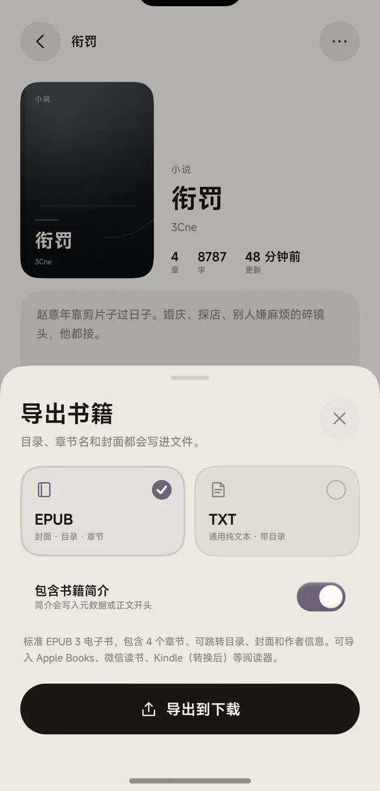
</p>

---

书架上一本书一张封面，点开是目录，再点一章进正文。一章一份，写完这章开下一章。

## 故事

书详情里的一栏，三页：角色、时间线、大纲。

- **角色**：每个角色一个球，名字缩在圈里，颜色自己挑。点一个看它跟谁什么关系、在哪几章出场。
- **时间线**：事件按发生时间排成一条竖轴，每条挂上第几章、谁在场。一个事件可以跨好几章。
- **大纲**：每章一张卡，情节点一条条列进去，勾掉就是写过了。

AI 会顺手往里补：写完一章保存，它把这一章里写定的人和事记进去。你自己手改过的条目它不动，改错了能撤销最近一次。

## AI

问书读的是你正在写的这本，不是通用问答。问「第三章张满为什么知道赵念有嫌疑」，它翻原文回答；也会指着某一句话问你是不是漏了。

选中一段另有两件事：校核挑错别字、标点、病句；修饰把「他很生气」写成他做了什么。改完当场落进正文，不满意点撤销。

这些要自己填 Key。不填也能用，只是没有 AI。

## 笔记

写到一半想到什么，记成笔记。笔记放进笔记夹，能挂到某一章上；待办可以带时间提醒。

## 外观

底色三套，点缀色八个，也能自己拉色相。字体有衬线、无衬线、等宽三种，字号、行距、页边距、稿纸线都能调。深色浅色跟着手机走。

标签栏、镜片、输入框、按钮、通知那层玻璃，模糊、折射、阴影、边缘带、色散，每一项都能拖，旁边有实时预览。

## 导出

EPUB 和 TXT，存到 `下载/字隅`。EPUB 带封面和可跳转的目录，能导进 Apple Books、微信读书。

备份是一个 JSON 文件，换手机导回去接着写。

## 装

[Releases](https://github.com/3Cne/ziyu/releases) 里下 APK，Android 8.0 以上点开装。

以前叫字隅，现在叫素纸。包名没换，旧数据、旧备份都还在。

## 自己编译

JDK 17、Android SDK 37，根目录：

```bash
./gradlew :app:assembleRelease
```

签名参数从 `keystore.properties` 读（已 gitignore）。
